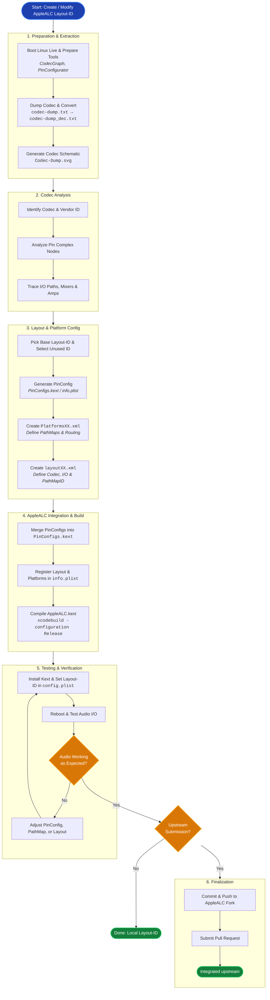

# AppleALC Layout Creation Workflow

## About

The processing workflow consists of six major phases, starting with obtaining and analyzing the audio codec data and ending with testing and optionally submitting the finished Layout-ID to the AppleALC repository.

The important aspect is that this is an iterative process: PinConfig, PathMap and Layout configuration may need to be adjusted repeatedly until the audio routing works correctly.

The diagram is designed as a high-level overview rather than a replacement for the detailed instructions in the individual chapters. It would fit well near the beginning of your README, immediately after the introduction and before the table of contents or preparation instructions.

## Workflow Diagram

### Phases

| Phase              | Main objective                                    | Primary output            |
| ------------------ | ------------------------------------------------- | ------------------------- |
| 1. Preparation     | Obtain and convert codec data                     | Codec dump and schematic  |
| 2. Analysis        | Identify nodes, signal paths and amp capabilities | Audio routing map         |
| 3. Configuration   | Create PinConfig, PathMap and Layout              | Three configuration files |
| 4. Integration     | Register all components in AppleALC               | Integrated source files   |
| 5. Build & Testing | Compile, install and validate                     | Working AppleALC.kext     |
| 6. Finalization    | Submit changes upstream (optional)                | AppleALC Pull Request (optional)   |

### Phases in Detail

The following 3 aspects deserve particular attention in the diagram:

1. PinConfig and PathMap dependency: All nodes referenced in `PlatformsXX.xml` must also exist in the PinConfig. This makes their configuration interdependent.
2. Iterative troubleshooting: Testing is not simply the final step. Failed tests send you back to the configuration stage to adjust the PinConfig, PathMap or Layout.
3. Optional upstream contribution: A working custom Layout-ID does not necessarily have to be submitted to AppleALC. Pull Request submission is a separate final step.
